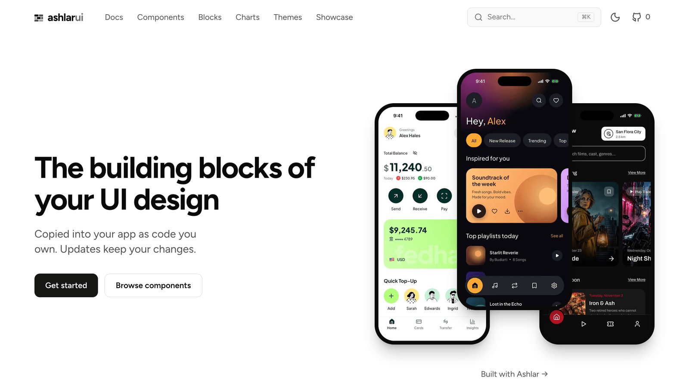

<p align="center">
  <picture>
    <source media="(prefers-color-scheme: dark)" srcset="assets/mark-dark.svg" />
    
  </picture>
</p>

<h2 align="center">The building blocks of your UI design.</h2>

<p align="center">
  Flutter components copied into your app as code you own. Updates keep your changes.
</p>

<p align="center">
  <a href="https://github.com/mittolabs/ashlar-ui/actions/workflows/build.yml"></a>
  <a href="https://github.com/mittolabs/ashlar-ui/actions/workflows/tests.yml"></a>
  <a href="https://pub.dev/packages/ashlar"></a>
  <a href="https://pub.dev/packages/ashlar/score"></a>
  <a href="LICENSE"></a>
</p>

<p align="center">
  <a href="https://ui.ashlar.ke"></a>
</p>

## Get started

```sh
dart pub global activate ashlar
ashlar init && ashlar add button
```

Everything else is at [ui.ashlar.ke](https://ui.ashlar.ke).

## Contributing

Read the [contributing guide](CONTRIBUTING.md).

## Licence

MIT. See [LICENSE](LICENSE).
